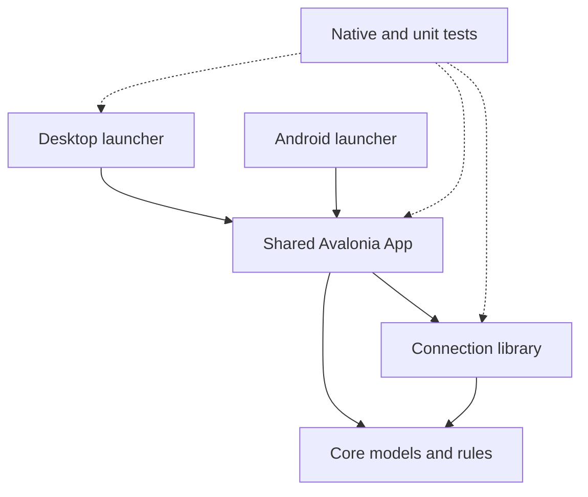

# Companion client architecture

Updated 11 November 2026. This describes the implemented native clients. [UI-UX-PLAN.md](UI-UX-PLAN.md) owns the screen/state inventory and refinement sequence, [DESIGN.md](DESIGN.md) owns appearance and interaction rules, and [BUILD-PLAN.md](BUILD-PLAN.md) owns wider delivery status. The native client is separate from the React management dashboard in `lucia-dashboard`.

## Projects and entry points

All native client code is under `clients/Lucia.Companion/`.

| Project | Responsibility | Start reading |
|---|---|---|
| `Lucia.Companion.Core` | Immutable home/observation/history models, quality semantics, local profile contracts and pure hold rules. No Avalonia or network dependency | `HomeTopology.cs`, `Place.cs`, `Observation.cs`, `StoryDay.cs`, `HoldGesture.cs` |
| `Lucia.Companion.Connection` | Protected session coordination, HTTPS transport, grant checks and typed responses | `ICompanionConnection.cs`, `CompanionConnection.cs`, `ProtectedSessionVault.cs` |
| `Lucia.Companion.App` | Shared native controls, screens, view models, themes, persistence coordination and presentation motion | `App.axaml`, `App.axaml.cs`, `CompanionRoot.cs`, `CompanionShell.axaml.cs` |
| `Lucia.Companion.Desktop` | Desktop launcher and Windows DPAPI adapter | `Program.cs`, `Security/WindowsDeviceSecretProtector.cs` |
| `Lucia.Companion.Android` | Android application/activity, lifecycle, platform text sizes and Keystore adapter | `AndroidApplication.cs`, `MainActivity.cs`, `Security/AndroidDeviceSecretProtector.cs` |
| `Lucia.Companion.Tests` | Pure model, persistence, protected transport and native headless interaction/render tests | `TestAppBuilder.cs`, `NativeCapture.cs`, the tests for the relevant control |



Desktop and Android use the same screens and user controls. They do not render the HTML artboards, and there is no separate mobile UI implementation. There is no iOS launcher yet.

## Composition and state

`CompanionRoot` starts on Connection and opens the demo only through explicit selection. A verified connection opens `ConnectedHomeWorkspace`, whose controllers read permitted data into `HomeViewModel` and the shared shell. A failed connection never substitutes sample household data.

The root wraps its content in `Controls/InputPaneViewport.cs`. It observes the top level's input pane, reserves only the docked keyboard area that overlaps the existing safe-area viewport, and brings the unchanged focused field into view after layout. Detach removes the observer, clears the inset and invalidates deferred focus work. Status bars and navigation bars remain under Avalonia's existing safe-area handling.

`CompanionShell` owns the four destinations, local save status and full-screen setup/conflict workflows. `ShellNavigation` changes from a bottom bar to a rail at 600 logical units. The rail has an 88-unit minimum and grows through native label measurement; bottom navigation retains its wrapping rules. `HomeScreen` adapts its overview/detail composition at 900 units. Story has its own width and text-size adaptations. Available space and text size decide layouts rather than a phone/tablet device-name check.

`HomeViewModel` owns selection, open detail/actions, pins and section order. Immutable incoming data updates existing place controls when layout identity is unchanged, preserving focus and an active hold. `HomeProfileSession` coordinates checked profile persistence. Controls request changes; they do not obtain household credentials or issue physical commands.

## Design mapped to controls

Paths below are relative to `Lucia.Companion.App/`.

| Design concept | Implementation | Ownership |
|---|---|---|
| Place constellation and connections | `Controls/HomeConstellation.axaml.cs`, `ConstellationPanel.cs`, `ConnectionLayer.cs` | Stable place order, configured edges, input gesture coordination |
| Place orb, state, selection and charge | `Controls/PlaceOrb.cs`, `HoldCharge.cs`, `Styles/Controls.axaml` | Native button semantics, written state, semantic brushes and a decorative hold arc |
| Contextual Bloom | `Controls/BloomActions.axaml`, `BloomActions.axaml.cs`, `BloomActionButton.cs` | Named actions, radial/list presentation, unfold/fold and protected idle dismissal |
| Needs you | `Controls/AttentionList.cs`, `AttentionPlaceRow.cs` | Retained place actions, current explanations, press/focus continuity and deliberate removal fallback |
| Place detail/page | `Controls/PlaceDetail.axaml`, `PlacePage.axaml` | Shared observations and explanation, compact page or expanded side pane |
| Story dial, chapters and tracks | `Screens/StoryScreen.axaml`, `Controls/StoryOrbit.cs`, `ChapterList.cs`, `PlaceTimeline.cs`, `TimelineTrackLayer.cs` | Shared selected instant and filter, native text/buttons beside drawing |
| Shared button feedback | `Controls/InteractionFeedback.cs` | Mouse hover, press compression, finite colour transitions and lifecycle cleanup |
| Contextual help | `Controls/ContextHelp.cs` | Delayed wrapping tooltips with matching accessible help |
| Reading continuity and update feedback | `Controls/ObservationRows.cs`, `ObservationRow.axaml.cs` | Retain unique rows within exact place/binding scope, update real text immediately and apply one finite emphasis |
| Actual operation progress | `Controls/OperationProgress.cs` | Native indeterminate activity only while the owning controller/session is busy; static dots for reduced motion |
| View/stage arrival | `Controls/SurfaceEntrance.cs` | One finite position settle on approved presentation boundaries; no replay on ordinary data refresh |
| Presentation visibility | `Controls/PresentationVisibility.cs` | Observe the owner and its ancestors so hidden, detached or backgrounded presentation stops |
| Colour, type and control templates | `App.axaml`, `Styles/Controls.axaml`, `Assets/Fonts/` | Observatory light/dark semantic roles, local Outfit/DM Sans and consistent native targets |

Story, charts and Today so far are labelled sample data in the demo. Connected historical Story and Engine room remain incomplete. Appearance does not establish data capability or authorization.

## Input and motion

Home exposes a direct Review reports shortcut and an empty-home setup route through the existing shell editor flow. Setup entry focuses the home-name field; returning restores the visible invoker or Home navigation. Connection removal remains behind an explicit disclosure and the existing confirmation. Collapsed options are excluded from visibility and focus immediately.

Story chapters cache against the actual view model as well as chapter/filter identity. Date navigation therefore cannot retain handlers for the previous day. Timelines are cached within one immutable day model and reconciled by place ID; a report remains attached when selecting it narrows the filter. Bloom maps focus between equivalent radial/list actions after text adaptation, with version and intervening-focus guards. Effective hiding cancels pending holds and closes overlays immediately.

The pure `HoldGesture` distinguishes a quick tap, pending hold, scroll cancellation and a completed hold. `HomeConstellation` supplies elapsed time and pointer events, draws charge only while pending, and suppresses the tap after a hold. `HomeScreen` owns the popup's anchor, selected-place actions and focus return. The same actions remain reachable through named buttons and the native context menu.

Android can request a context menu independently of the framework's Holding gesture. The orb consumes context requests while its Bloom hold is pending or active, preventing two menus from stacking. After release, the regular context-menu route remains available.

Home records the overview scroll offset and the actual page invoker before opening a compact place page. The page starts at zero offset; return restores the overview and a visible valid invoker or deliberate fallback. A navigation version and intervening-focus guard prevent old callbacks from affecting another destination.

`BloomActions` owns its presentation timers. Actions travel from the selected centre in 240 ms with a maximum 45 ms stagger; closing travels inward for 140 ms. A pointer-opened radial menu folds after one idle second. An active hold, hovered action, keyboard session or large-text list keeps choices available. Opening again cancels an old closing completion. Once folding starts, its actions stop accepting input.

`InteractionFeedback` attaches to native buttons through an attached style property. State colours interpolate for 200 ms; ordinary feedback uses 120–180 ms. Place and Bloom action hover uses a 2% scale change, and pressing compresses to 97.5%. Content alignment and padding remain part of the templates. Information rows retain left-aligned text. Keyboard focus stays immediate and distinct from hover.

`MotionSettings` combines the saved device preference, a separate system reduction request and a temporary background pause. Windows and Android restore the preference before constructing controls. `AndroidMotionObserver` reads the current `Settings.Global.AnimatorDurationScale` at startup/resume and observes it while foregrounded. Zero or invalid scale suppresses effects without persisting or replacing the personal setting. More reports the override. Under reduced motion, controls settle immediately and a pending hold shows a static indication. All new transitions and timers stop on detach or backgrounding. The only custom frame timer is the active pending hold. No polling timer drives decorative motion.

The shell owns one `CompanionCrossFade` with native 180 ms opacity transitions and CubicEaseInOut. Each new transition starts from the painted opacity and cancels the old operation. `Stop` removes the transitions, restores opacity and settles visibility synchronously. Backgrounding or a live reduction request therefore cannot leave an old page partially visible or hide the newest page when its old completion arrives.

The Story dial and straight-track cursors use the same 280 ms selection transition and the same Animate the time hand setting. Selection labels and source timestamps update immediately. Colour interpolation and cursor travel never alter observations, fabricate a lifecycle stage or infer occupancy.

Reading rows are retained by unique label/role only inside an unchanged place and exact ordered binding scope. The current observation model lacks a per-reading source ID, so ambiguous duplicate labels and changed provenance start fresh. Removed readings leave immediately. `ObservationRow.Update` writes the complete new value, quality and timing first, then allows a 360 ms soft background emphasis for a meaningful value/quality change. It never interpolates numeric data, hides the new words, replays on a timestamp-only update or queues old changes.

`OperationProgress` reads no services and owns no progress clock. Views feed their existing busy flags for Connection, Home, activity, shared review, local-profile loading and conflict review. The native progress bar is indeterminate, with no percentage text. Three static dots replace it under reduced motion. `PresentationVisibility` observes ancestor visibility and stops activity immediately when the containing view is hidden.

`SurfaceEntrance` is enabled only on transform-free presentation containers for Connection stages, verified Home readiness and the place page. It keeps text fully visible while translating four logical units to rest over 220 ms. Data refresh, keyboard focus and preference changes do not replay it. Existing shell navigation owns the other screen transitions. Charts render their actual evidence and unknown coverage immediately, with no invented intermediate readings or simulated loading for absent history.

## Local save feedback

`HomeProfileSession.IsSaving` counts the entire serial queue, including snapshots waiting for older writes. `RequiresGlobalNotice` combines actual loading/saving with recovery flags. The shell never infers state by matching status strings. Each completed intermediate write advances the checked revision; only the latest request confirms success. Review and resolution cannot overtake pending writes.

The shell keeps progress and failure/conflict recovery global, but moves idle context into More. Setup explains its draft and explicit apply action. Versioned completed-outcome text appears on the current Home overview or place page. Navigation consumes it without replay, and conflict handlers recheck their originating view before returning. Retry focus moves to status while pending and to the current destination when the notice closes. A memory-only session publishes no durable-save confirmation.

`StoryWeek` measures date/count/ruler text at the mapped font sizes. It reserves text columns or moves the lane below its header, reducing tick density when necessary. Font changes are coalesced after layout and retain the native action controls. This adaptation does not infer extra reports or change their times.

## Persistence and service boundary

Local home metadata uses `LocalHomeStore` with revision checks and explicit conflict recovery. Reduce motion uses a separate device-local preference file, with same-directory replacement and visible failure feedback. Protected session material stays in the vault and platform protection adapters. Report snapshots, display animation state and background pause are not persisted as household history.

The existing AgentHost remains the service boundary. The planned v2 member identity and `/api/me` port will replace the pilot identity/session integration; it must preserve the shared UI and the distinction between permission, metadata and report quality. Server, pairing, grant and migration changes remain on hold until that direction settles.

## Run and qualify

From the repository root:

```powershell
dotnet run --project clients/Lucia.Companion/Lucia.Companion.Desktop
dotnet test clients/Lucia.Companion/Lucia.Companion.Tests
dotnet build clients/Lucia.Companion/Lucia.Companion.Android -p:AndroidSdkDirectory="$PWD/.tools/android-sdk"
```

Choose Explore the demo for the sample Home and Story. Native tests can capture phone/tablet light/dark frames through `LUCIA_COMPANION_CAPTURE_DIR`. Headless interaction and rendered-frame checks establish bounded desktop/native behavior. Android hardware frame time, touch feel, TalkBack, safe areas, predictive Back, installed connection recovery and iOS still require their own qualification.
