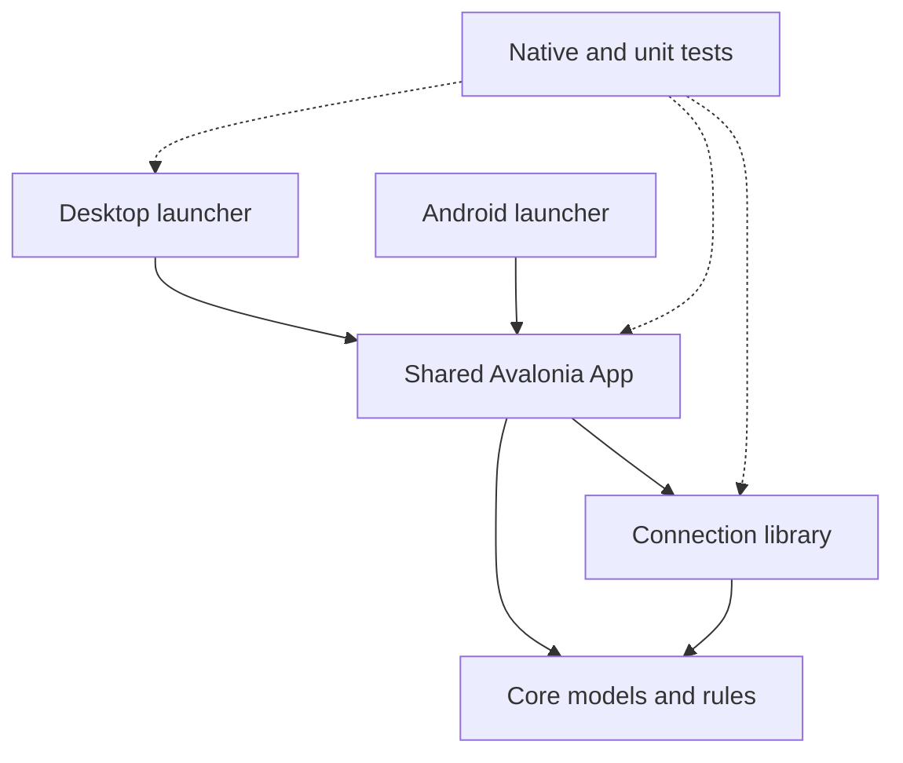

# Companion client architecture

Updated 10 November 2026. This describes the implemented native clients. [DESIGN.md](DESIGN.md) owns appearance and interaction rules; [BUILD-PLAN.md](BUILD-PLAN.md) owns delivery status. The native client is separate from the React management dashboard in `lucia-dashboard`.

## Projects and entry points

All native client code is under `clients/Lucia.Companion/`.

| Project | Responsibility | Start reading |
|---|---|---|
| `Lucia.Companion.Core` | Immutable home/observation/history models, quality semantics, local profile contracts and pure hold rules. No Avalonia or network dependency | `HomeTopology.cs`, `Place.cs`, `Observation.cs`, `StoryDay.cs`, `HoldGesture.cs` |
| `Lucia.Companion.Connection` | Protected session coordination, HTTPS transport, grant checks and typed responses | `ICompanionConnection.cs`, `CompanionConnection.cs`, `ProtectedSessionVault.cs` |
| `Lucia.Companion.App` | Shared native controls, screens, view models, themes, persistence coordination and presentation motion | `App.axaml`, `App.axaml.cs`, `CompanionRoot.cs`, `CompanionShell.axaml.cs` |
| `Lucia.Companion.Desktop` | Desktop launcher and Windows DPAPI adapter | `Program.cs`, `Security/WindowsDeviceSecretProtector.cs` |
| `Lucia.Companion.Android` | Android application/activity, lifecycle, platform text sizes and Keystore adapter | `AndroidApplication.cs`, `MainActivity.cs`, `Security/AndroidDeviceSecretProtector.cs` |
| `Lucia.Companion.Tests` | Pure model, persistence, protected transport and native headless interaction/render tests | `TestAppBuilder.cs`, `NativeCapture.cs`, the tests for the relevant control |



Desktop and Android use the same screens and user controls. They do not render the HTML artboards, and there is no separate mobile UI implementation. There is no iOS launcher yet.

## Composition and state

`CompanionRoot` starts on Connection and opens the demo only through explicit selection. A verified connection opens `ConnectedHomeWorkspace`, whose controllers read permitted data into `HomeViewModel` and the shared shell. A failed connection never substitutes sample household data.

`CompanionShell` owns the four destinations, local save status and full-screen setup/conflict workflows. `ShellNavigation` changes from a bottom bar to a rail at 600 logical units. `HomeScreen` adapts its overview/detail composition at 900 units. Story has its own width and text-size adaptations. Available space and text size decide layouts rather than a phone/tablet device-name check.

`HomeViewModel` owns selection, open detail/actions, pins and section order. Immutable incoming data updates existing place controls when layout identity is unchanged, preserving focus and an active hold. `HomeProfileSession` coordinates checked profile persistence. Controls request changes; they do not obtain household credentials or issue physical commands.

## Design mapped to controls

Paths below are relative to `Lucia.Companion.App/`.

| Design concept | Implementation | Ownership |
|---|---|---|
| Place constellation and connections | `Controls/HomeConstellation.axaml.cs`, `ConstellationPanel.cs`, `ConnectionLayer.cs` | Stable place order, configured edges, input gesture coordination |
| Place orb, state, selection and charge | `Controls/PlaceOrb.cs`, `HoldCharge.cs`, `Styles/Controls.axaml` | Native button semantics, written state, semantic brushes and a decorative hold arc |
| Contextual Bloom | `Controls/BloomActions.axaml`, `BloomActions.axaml.cs`, `BloomActionButton.cs` | Named actions, radial/list presentation, unfold/fold and protected idle dismissal |
| Needs you | `Controls/AttentionList.cs` | Evidence-based attention rows with readable explanations |
| Place detail/page | `Controls/PlaceDetail.axaml`, `PlacePage.axaml` | Shared observations and explanation, compact page or expanded side pane |
| Story dial, chapters and tracks | `Screens/StoryScreen.axaml`, `Controls/StoryOrbit.cs`, `ChapterList.cs`, `PlaceTimeline.cs`, `TimelineTrackLayer.cs` | Shared selected instant and filter, native text/buttons beside drawing |
| Shared button feedback | `Controls/InteractionFeedback.cs` | Mouse hover, press compression, finite colour transitions and lifecycle cleanup |
| Contextual help | `Controls/ContextHelp.cs` | Delayed wrapping tooltips with matching accessible help |
| Colour, type and control templates | `App.axaml`, `Styles/Controls.axaml`, `Assets/Fonts/` | Observatory light/dark semantic roles, local Outfit/DM Sans and consistent native targets |

Story, charts and Today so far are labelled sample data in the demo. Connected historical Story and Engine room remain incomplete. Appearance does not establish data capability or authorization.

## Input and motion

The pure `HoldGesture` distinguishes a quick tap, pending hold, scroll cancellation and a completed hold. `HomeConstellation` supplies elapsed time and pointer events, draws charge only while pending, and suppresses the tap after a hold. `HomeScreen` owns the popup's anchor, selected-place actions and focus return. The same actions remain reachable through named buttons and the native context menu.

`BloomActions` owns its presentation timers. Actions travel from the selected centre in 240 ms with a maximum 45 ms stagger; closing travels inward for 140 ms. A pointer-opened radial menu folds after one idle second. An active hold, hovered action, keyboard session or large-text list keeps choices available. Opening again cancels an old closing completion. Once folding starts, its actions stop accepting input.

`InteractionFeedback` attaches to native buttons through an attached style property. State colours interpolate for 200 ms; ordinary feedback uses 120–180 ms. Place and Bloom action hover uses a 2% scale change, and pressing compresses to 97.5%. Content alignment and padding remain part of the templates. Information rows retain left-aligned text. Keyboard focus stays immediate and distinct from hover.

`MotionSettings` combines the saved device preference with a temporary background pause. Windows and Android restore the preference before constructing controls. Under reduced motion, controls settle immediately and a pending hold shows a static indication. All new transitions and timers stop on detach or backgrounding. The only frame timer is the active pending hold. No polling timer drives decorative motion.

The Story dial and straight-track cursors use the same 280 ms selection transition and the same Animate the time hand setting. Selection labels and source timestamps update immediately. Colour interpolation and cursor travel never alter observations, fabricate a lifecycle stage or infer occupancy.

## Persistence and service boundary

Local home metadata uses `LocalHomeStore` with revision checks and explicit conflict recovery. Reduce motion uses a separate device-local preference file, with same-directory replacement and visible failure feedback. Protected session material stays in the vault and platform protection adapters. Report snapshots, display animation state and background pause are not persisted as household history.

The existing AgentHost remains the service boundary. The planned v2 member identity and `/api/me` port will replace the pilot identity/session integration; it must preserve the shared UI and the distinction between permission, metadata and report quality. Server, pairing, grant and migration changes remain on hold until that direction settles.

## Run and qualify

From the repository root:

```powershell
dotnet run --project clients/Lucia.Companion/Lucia.Companion.Desktop
dotnet test clients/Lucia.Companion/Lucia.Companion.Tests
dotnet build clients/Lucia.Companion/Lucia.Companion.Android -p:AndroidSdkDirectory="$PWD/.tools/android-sdk"
```

Choose Explore the demo for the sample Home and Story. Native tests can capture phone/tablet light/dark frames through `LUCIA_COMPANION_CAPTURE_DIR`. Headless interaction and rendered-frame checks establish bounded desktop/native behavior. Android hardware frame time, touch feel, TalkBack, safe areas, predictive Back, installed connection recovery and iOS still require their own qualification.
