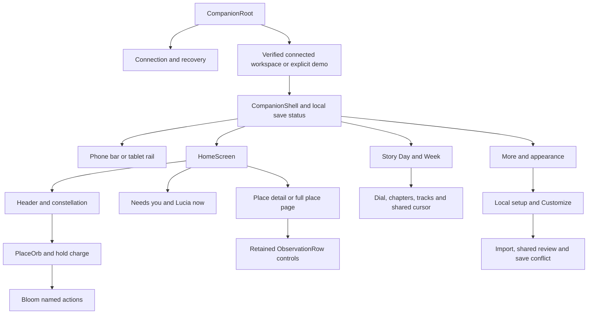

# Native UI and UX refinement plan

11 November 2026. This is the implementation plan for the existing native Companion UI after F04. [DESIGN.md](DESIGN.md) owns visual rules, [ARCHITECTURE.md](ARCHITECTURE.md) owns code responsibilities, and [BUILD-PLAN.md](BUILD-PLAN.md) retains the wider W1–W6 delivery gates.

## Purpose and authority

Household members need to read their home's reports, understand uncertainty, find the next action and keep their place while data changes. The interface uses Constellation composition, Observatory semantic colours, Outfit headings, DM Sans text and native input semantics in both themes. This refinement preserves that direction and the existing adaptive layouts.

The source artboards establish appearance and composition. They do not establish live data, authorization, occupancy, physical success or performance. The existing server/v2 hold remains in force. Implementing this plan changes presentation and local UI composition, not pairing, sessions, grants, migrations or physical controls.

## Screen and component hierarchy

Composition follows available width and text size. Phone keeps one task at a time; tablet adds useful adjacent detail. Reading rows stay left aligned; action labels are centred vertically with side clearance. No gesture, hover, colour or animation is the only way to understand or activate a control.

## Screen and state inventory

| Screen or view | Loading / first appearance | Ready and changed data | Empty, stale, failure and recovery | Navigation, focus and input |
|---|---|---|---|---|
| Connection | Show the actual operation status and an indeterminate indicator only while `State.IsBusy`. Stage groups may arrive with one short settle | Form, approval and verified views expose the actual current stage. Approval waiting is not measured progress | Keep host/code/grant identity, explicit retry and protected recovery. No demo substitution | Preserve typed input, Back and conservative removal focus. Essential guidance stays visible |
| Connected workspace | Verify access before reports appear. Actual pending reads show progress. Ready Home may settle once after a successful read | Keep a verified Home during permitted automatic refresh; do not replay arrivals on every poll | Clear protected reports immediately on failure, suspend or authority loss. Errors never fade out slowly or borrow sample content | Existing retry waits and Connection action remain authoritative. Recovery status retains its focus rules |
| Home | Retain the existing header, saved section order and stable place slots | Update existing orbs. F04 state-colour easing remains finite and does not replay for identical states | Existing no-places, unavailable, stale and attention wording stays explicit | Tap opens readings; hold charges then opens Bloom; context menu and named buttons remain equivalent |
| Place side pane / page | A page can settle once when opened. Initial readings appear at their actual values | Retain uniquely identified reading rows within the same place and source-binding scope. Briefly emphasize meaningful value/quality changes | Unknown/stale/unavailable text and last-known values appear immediately. Removed or newly disallowed readings leave immediately | Preserve the current page, focus and Why shown choice on data refresh. A different place or binding scope starts a fresh presentation |
| Story Day / Week | Local demo/date changes are immediate data operations, not network loading. Existing shell navigation and shared cursor motion provide continuity | Keep Day/Week selection and linked dial/track cursors. Do not fabricate frames between observations | Sample labels, unknown tracks and hatched future remain visible. Connected Story keeps its honest unavailable state | Named reports, chapters, slider and dates supplement drawn input; selection remains interruptible |
| Charts and timelines | Axes, quality, gaps and complete available evidence render immediately. Parent page arrival may supply the first-draw motion | Use actual series and a shared selected instant. Never count through invented sensor values or extend a line across missing history | Draw unknown coverage and future immediately. No fake skeleton data or loader for an unimplemented history service | Drawing supplements textual values and equivalent native controls |
| Lucia activity | A progress indicator reflects an actual activity read, not a claimed request stage | Keep keyed request controls and source-reported stages; F04 button feedback remains shared | Keep separate permission, partial coverage and recovery wording. No speculative success or origin | Existing focus recovery and explicit refresh stay intact; healthy polls do not announce repeatedly |
| More / Customize | Local preferences and section ordering are immediate. Do not add artificial waiting | Preserve stored motion choice and saved section order | Storage failure keeps the current session choice and written failure | Normal keyboard/touch controls, disabled boundaries and contextual help |
| Home setup / local import | Editing and local preview remain immediate, with no manufactured loading | Keep the draft, bindings, explicit review and separate Save | Keep invalid/missing bindings and corrupt/conflicting profiles visible | Back preserves the draft until explicit discard. Do not animate field values or silently replace the draft |
| Shared setup review | Progress reflects the controller's protected read/recheck | Show reviewed alternatives and replacement consequences | A failed or stale review is cleared immediately while the local draft survives | Keep explicit reread/add/cancel, separate local Save and current focus rules |
| Save conflict | Show progress only while the session is actually reading/resolving | Present both real alternatives; choosing remains explicit | Never imply a save succeeded before confirmation; preserve unreadable bytes and the session draft | Keep conservative focus and disabled choices while busy |
| Demo control lab | Explicitly labelled fixtures render immediately; no simulated household loading | Existing state/control specimens remain available for inspection | Keep fixture identity and sample notices visible | This remains a demo tool; it does not send commands or supply connected data |

## Motion and feedback contract

| Trigger | Treatment | Timing / easing | Suppression and interruption |
|---|---|---|---|
| First appearance of an approved view or connection stage | Translate from 4 logical units below to its final position; keep text visible | 220 ms, CubicEaseOut | Snap under reduced motion/background. Cancel on detach/hide. No per-card parade or repeated reveal on refresh |
| New current value, last-known value or quality in the same source scope | Show the exact new words immediately; fade a soft background emphasis around the retained row | 360 ms, CubicEaseOut | No emphasis on first bind, timestamp-only changes, identical refresh, ambiguous identity, hidden/detached controls or reduced motion. Rapid updates replace the current emphasis rather than queueing |
| Actual unknown-duration async work | Native indeterminate progress, with actual status text nearby | Only while the operation is busy | No invented percentage or timer-generated phase. Static dots under reduced motion. Stop on completion, detach, background or hidden presentation |
| Recovery or access loss | Hide protected content and stale alternatives immediately | No exit delay | Security/data truth overrides decorative motion |
| Navigation | Shell-owned interruptible native opacity transition | 180 ms, CubicEaseInOut | A new operation cancels the old one; reduction/background settles visibility immediately. Page entry and Back preserve their own scroll/focus context |
| Press, hover and state repaint | Retain F04 finite transform/brush feedback | Existing 120–200 ms | Respect mouse/keyboard distinction, disabled state and reduced motion |
| Hold and Bloom | Retain F04 charge, centre-out petals, faster fold and protected idle dismissal | Hold 450 ms; petals 240 ms plus at most 45 ms stagger; fold 140 ms | Scroll/capture loss cancel charge. Keyboard, action hover, large text and active holds protect choices. Reversals continue from painted state |
| Story selection | Retain the linked dial and straight-track transition | Existing 280 ms, CubicEaseOut | Same setting for both; words and selected instant update immediately |

Only a genuine pending operation may animate continuously. Decorative effects finish and stop. No shimmer, ambient pulse, unbounded particles or fake event ripples. Animations use transforms, brushes and opacity rather than animating layout or repeatedly reconstructing control trees.

### Work and performance budgets

The target is a 16.7 ms frame budget at a 60 Hz baseline; this is a W6 measurement target, not a result established by headless tests. Presentation frames must not perform file/network I/O, save preferences, reproject source data or reconstruct reading rows.

| Component | Work bound |
|---|---|
| Retained reading row | One opacity effect per visible row, at most 360 ms after the latest meaningful change; no queued prior effects or per-frame text/value calculation |
| Approved arrival container | One transform transition per actual appearance, at most 220 ms; no replay on routine polling |
| Operation progress | One native indicator per operation view; runs only while actually busy and visible; reduced motion is static |
| Hold charge | One 16 ms custom timer per active pending hold; stop on release, cancellation or threshold |
| Bloom | Four petal transforms, at most 285 ms including stagger; 140 ms exit; no idle animation |
| Story and charts | Keep the current ring budget and explicit evidence coverage. Animate only the shared presentation cursor; do not interpolate historical records or regenerate source data per frame |

Source updates can change several visible facts together. Preserve every fact even when animation is suppressed; animation budgets must never become data filters.

## Implementation sequence and acceptance

| ID | Delivery | Current status | Acceptance |
|---|---|---|---|
| UX01 | Formal screen/state inventory, hierarchy and motion contract | Delivered | This document linked from build plan, handoff and architecture; dependencies and deferred work explicit |
| UX02 | Stable observation controls and truthful value-change emphasis | Delivered | Retained rows update exact text immediately; timestamp/identical updates stay quiet; changed source scope and duplicate labels do not invent continuity; removal and lifecycle stop effects |
| UX03 | Shared progress component across current async views | Delivered | Actual controller/session busy flags drive it; completion, failure, background and detach stop it; reduced motion has a static equivalent |
| UX04 | Bounded first-draw/stage arrival at the actual presentation boundaries | Delivered | Ready Home, connection stages and place-page opening use one short settle; ordinary refresh never replays it; focus and layout survive interruption |
| UX05 | Native interaction/render regression and public handoff | Delivered within the app-only scope | 677 native tests pass, 3 existing wire skips, 24 new cases; Android zero warnings/errors. Phone/tablet light/dark 1x/2x captures, intermediate frames, handoff and HTML record checked. Hardware remains a separate gate |

These are implementation deliveries, not new server features. Existing working controls remain accepted unless a concrete gap is listed above. Default implementation order is UX01 through UX05, one delivery at a time.

## Qualification and deferred decisions

The owner renewed the app-only improvement goal on 11 November with a 9.5/10 mean target. [UI-UX-QUALITY.md](UI-UX-QUALITY.md) owns the fixed scorecard, review trend and next qualification needs. Cycle 1 retains attention actions across report changes, adds direct attention/setup routes, clarifies recovery, fixes Story model/focus continuity and hardens hidden controls. Its implementation does not complete the scoring goal. Cycle 2 adds page scroll/invoker continuity, cancellable native fades, independent Android system-motion reduction, a keyboard-aware root viewport and suppression of duplicate native menus during Bloom holds. The mean is now 8.87; 734 native cases pass with 3 existing opt-in skips. The owner requested emulator testing while physical devices are unavailable.

Installed-APK simulation now covers phone/expanded layouts, both themes, system text 2.0, real IME, system Back and animation-policy changes. Real-device touch feel, screen-reader behavior, broader safe areas, predictive Back, process death and measured frame time remain W6/Q gates for later. Headless frames and input establish bounded native behavior, not physical-device qualification.

Connected historical Story/Week, richer conversation stages, Engine room and the member API port remain gated on v2 and their existing owner decisions. Local-time presentation remains an owner decision. The plan does not introduce an iOS launcher or claim iOS qualification.

Cycle 3 clarifies Home and Day/Week wording, makes local save feedback follow machine-readable queued-operation state, retains global recovery, and adapts Week/rail layouts to measured text. It passes 754/757 native cases with 3 existing opt-in skips. The confirmed mean is 9.05; the 9.5 goal stays active.

Any future new control must state its data truth, identity key, empty/error/recovery behavior, input equivalents, motion trigger and stop conditions. Loading, rendering and source updates are separate events; an attractive transition must not blur those distinctions.

Implementation references: [Avalonia control transitions](https://docs.avaloniaui.net/docs/graphics-animation/control-transitions) and [indeterminate progress](https://docs.avaloniaui.net/controls/feedback/progressbar).

Cycle 4 completes UX10's compact-window and feedback-timing corrections. Naturally measured rail height decides the fallback, including live enlarged text. A continuous save queue has one 150 ms notice deadline, while recovery/loading remain immediate. Details discloses complete storage context and actions wrap at natural widths. Native verification passes 771/774 with 3 existing opt-in skips and 17 new cases. The confirmed mean is 9.07; UX07 and the 9.5 goal remain active.

Cycle 5 completes UX11. Story exposes mode-specific guidance without hover, and setup removal cannot leave an invalid selected-place page open. Keeping the selected place preserves its open page. Ten test-first cases cover both outcomes and native Day/Week input at normal/doubled text. Native verification passes 781/784 with 3 existing opt-in skips. The confirmed mean is 9.07; the 9.5 goal remains active.

UX12 is delivered and confirmed after installed review: removal confirmation must name the selected place, reveal its question and choices above the fixed command bar, and focus the safe Keep place action. Keep and Back return visible focus to Remove place; confirmation returns it to the remaining-place selector or Add place. Guard deferred moves against dismissal, changed selection, imports, detach, navigation and intervening user focus. After removal of Home's selected place, reveal an overview heading or empty-setup action; retain current page/scroll continuity when the place survives. Regressions must activate disclosure at the viewport bottom without test-side scrolling of the newly revealed choices.

Cycle 6 verifies UX12 with 801/804 native cases, 3 existing opt-in skips and 20 new cases, plus the installed APK. The initial full run caught a new continuity fixture whose content did not overflow; a shorter viewport now requires a real nonzero offset and passes. The final mean is 9.12. UX13 restores Home's approved "Tap for readings. Hold for actions." instruction while retaining named equivalents, empty-state suppression and the one-second Bloom idle contract.
